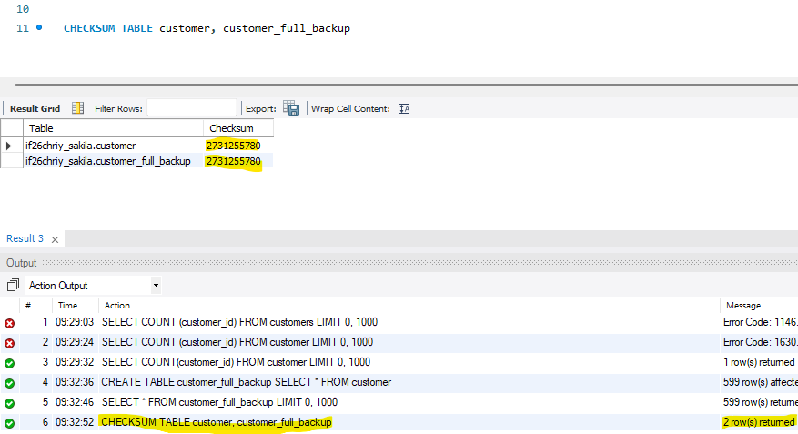
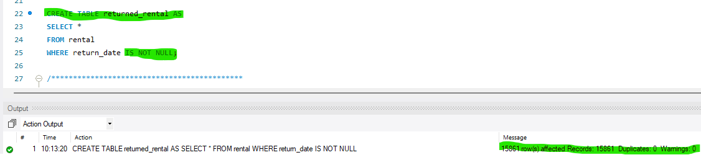
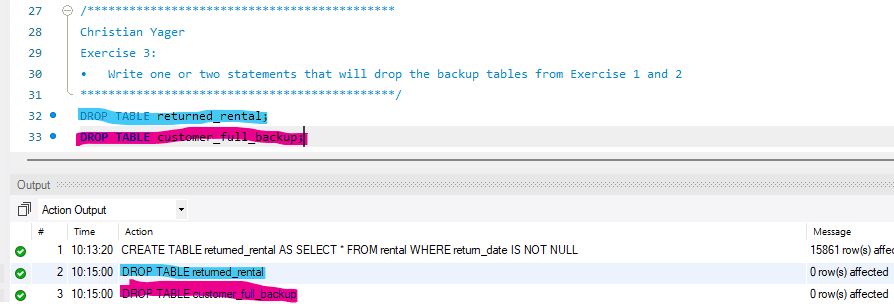
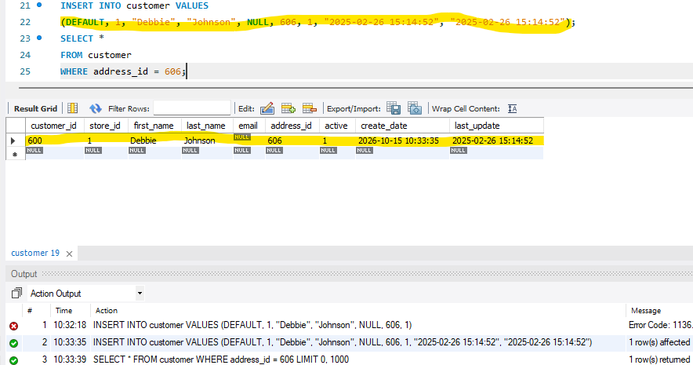
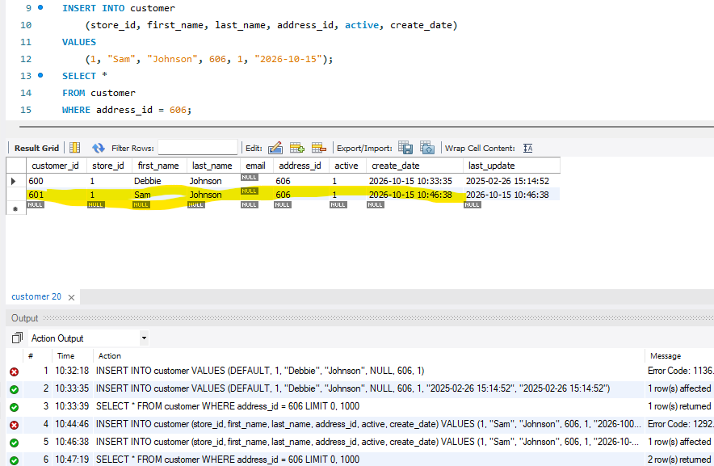
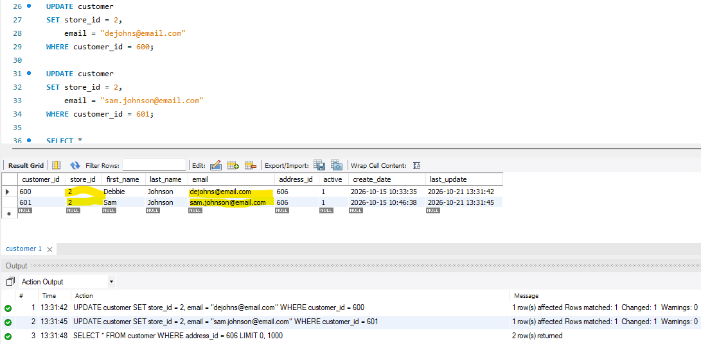
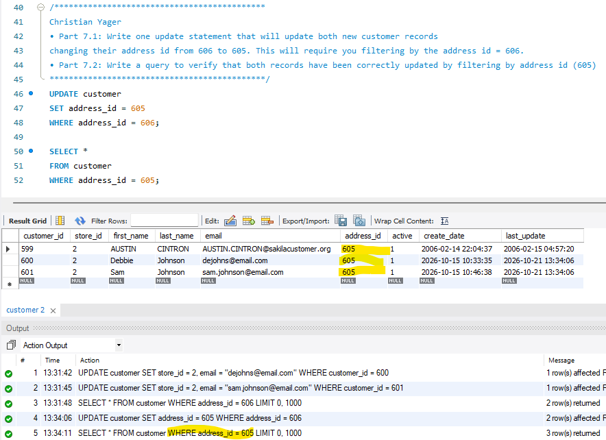
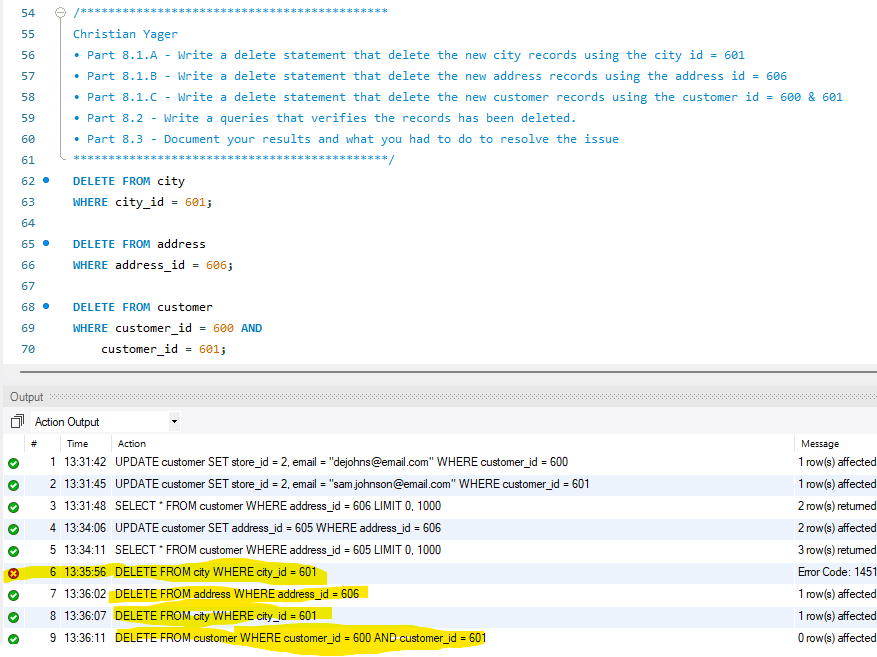

# MySQL_Chapter5

<b>Table of Content</b>
- [Summary](#summary)
- [Workers](#workers)
- [New Concepts Used](#new-concepts-used)
- [Browser Output Example](#browser-output-example)

## Summary
This is a list of exercises, the code done to use them, and the results of that code and its product.

## Workers
[@28cyager](https://github.com/28cyager) Christian Yager

## New Concepts Used
- DELETE
- INSERT
- CREATE
- DROP
- SET
- UPDATE
- CHECKSUM

## Browser Output Example
##Exercise 1

##Exercise 2

##Exercise 3

##Exercise 4

##Exercise 5

##Exercise 6

##Exercise 7

##Exercise 8

[Back to Top](#single-query)
